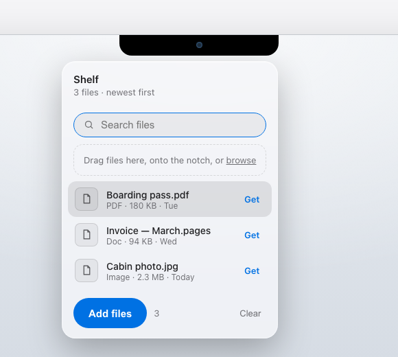
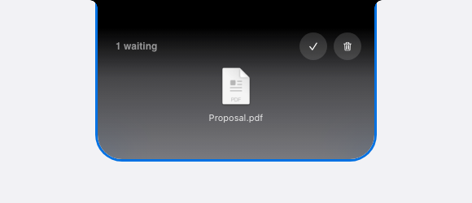
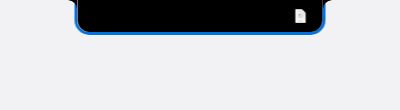

# Motion kit

Motion feel (timing, springs, how two shapes become one) is the hardest thing to get right and the easiest to get wrong. This kit ships it finished. Wire it up; don't re-invent it.

Decide what the motion should say before picking a technique. An instant state change is a valid answer.

Must be true (behaviour):

- Latest input wins and takes over smoothly.
- The final state is always correct.
- Controls stay reachable by keyboard.
- Listeners and observers are cleaned up.
- Reduce Motion goes straight to the end state.
- No empty panel: content and shape change together, nothing waits for anything to finish.
- Things close the way they opened: a panel that grew from the notch folds back into it, a zoom in zooms back out. Never a hard cut.
- Buttons never move or shrink when pressed; feedback lives in their content.

Your choice (feel):

- Timing character.
- Spatial metaphor.
- How shapes transform.
- Choreography and emphasis.

Optional techniques:

- Fly-to-target, catch bump, stagger, blur crossfade, tilt, camera zoom, dock, stack.

## How to work on motion

**New motion.** Start from what changes for the person: the real state before, the real state after, and what they should understand when it lands ("it went there", "it's saved", "it's listening"). If the direction is open, sketch two or three ideas that differ in what they say, not in easing: the item travels to its home, the container reshapes into the result, or things regroup where they are. Pick by what matters most here, and say why. Adding one file at a time, travel wins because you see where each one went. Adding twenty at once while you keep working, regrouping in place wins because twenty crossing flights hide the next button. If the person already chose a direction, build that one.

**Fixing motion.** Watch it at normal speed first and name what already works, so the fix doesn't lose it. Then find the cause of what's wrong. "Items show up late" was content waiting for a spring's long tail, not a slow spring; making it faster would have hidden the bug. Fix the cause, then replay the exact same steps and compare.

**References.** Take the reason a motion works, not its choreography. Petals gathering into an icon was SakuraCord's idea; on another product it's a copy, however it's reskinned. If the person asks you to match a reference exactly, do that and say so.

**When to stop.** When the must-be-true list holds, it looks right at normal speed, and nothing you'd change is more than taste. Offer the taste options; don't keep tuning.

## Use it

- Copy `motion.js` next to your page and load it: ``. Everything is on the global `Motion`.
- `gallery.html` shows every part playing on its own in a loop, one card each, with the line of code under it; hover a card to take over. Open it first and pick what fits. If none says what this interaction means, use an instant state change instead of the nearest card.
- `tour.html` is a welcome tour for Gaze (the face blinks, follows a light, nods, opens App Lock), built on the `onboarding-design` structure: the scene in a Mac, a camera zoom until the screen is the window, the notch growing into the live panel, and every page morphing that same panel with blur crossfades while the art, text and button never move.
- `notch-shelf.html` is a complete reference built with it: a notch you drag files into, which grows into a shelf. Open it next to `mac-assets` (from `mac-props`) and try it before building. Copy its patterns, never its page.

## The parts

- **Springs:** `Motion.spring(from, to, onUpdate, preset)` animates any numbers. Presets: `snappy` (controls), `smooth` (panels, morphs), `bouncy` (landing in place, one small bounce), `gentle` (big moves), `flight` (objects travelling along a path), `island` (Dynamic Island panels: fast, no overshoot), `swap` (content resizing inside a panel). Pass a starting velocity to continue a gesture. A new animation on the same element takes over from the current one smoothly, so opening and closing can interrupt each other. Pick by name. Never change the numbers per page.
- **Morph:** `Motion.morph(el, { width, height, radius })` grows one element into a new size and corner radius. Use it whenever something opens out of something else (notch into shelf, button into panel). One element, never a second box placed underneath.
- **Fly to a target:** `Motion.flyTo(source, target, { scale, lift, from })` sends a copy along an arc; it tilts into the turn, shrinks, blurs slightly at full speed, and the target catches it with a squash. Hide the source the moment the flight starts. Use a negative `lift` to drop things back down.
- **Catch bump:** `Motion.catchBump(el)` for "it arrived" or "it's back" (a quick squash and settle).
- **Buttons never move.** No press shrink, lift or bounce on buttons (house pick). Hover feedback is the MorphLabel from `design-patterns`: the label blurs into a symbol. `Motion.pressable` exists only for draggable objects and app-like tiles, never page buttons.
- **Drag:** `Motion.draggable(el, { targets: [{ el, radius, magnet, onEnter, onLeave, onDrop }] })` lifts the element and tilts it with its speed, pulls it towards a target when close (`magnet`, 0 to 0.5), lets the visitor flick it at a target, tells the target when it's near (grow it a little in `onEnter`), and springs home with the throw's momentum if it misses. Works with mouse, pen and touch.
- **Stagger:** `Motion.stagger(children, { show })` brings items in one after another, and out in reverse.
- **Reveal:** `Motion.reveal('[data-reveal]')` gives each section one entrance the first time it is seen. Put `data-reveal` on the headline group and the visual, not on every paragraph.
- **Expand and collapse:** `Motion.expand(detail, thumb)` grows a view out of the thing that opened it (card into detail); `Motion.collapse(detail, thumb)` shrinks it back.
- **Sliding selection:** `Motion.slideTo(indicator, button)` for segmented controls and tabs.
- **Count:** `Motion.countTo(el, value)` rolls numbers with tabular figures.
- **Popover:** `Motion.popIn(panel, button, { show })` grows a menu out of the button that opened it.
- **Toast:** `Motion.toast(el)` drops a banner from the top edge, waits, leaves upward.
- **Tilt:** `Motion.tilt(el)` follows the pointer in 3D on cards and product pictures; springs back flat.
- **Blur crossfade:** `Motion.blurSwap(el, () => write())` swaps content in place: old blurs out, new blurs in. Use for titles, button labels and panel content between pages.
- **Camera zoom:** `Motion.zoomTo(stage, focus, frame)` scales a whole scene so one part of it fills the frame (the Mac's screen becoming the window).
- **Headline reveal:** `Motion.textReveal(h1)` brings words out of a blur one by one when first seen. One headline per page, not every line.
- **Notification stack:** `Motion.stack(el)` piles cards with depth (lower, smaller, dimmer, slightly blurred); hover fans them out; `.push(card)` adds one on top.
- **Dock magnification:** `Motion.dock(el)` swells icons with pointer distance, like the macOS Dock.
- **Scene:** `Motion.scene(section, p => …)` gives 0 to 1 progress through a pinned scroll section; `Motion.segment(p, a, b)` turns part of it into its own eased 0 to 1 for choreography.

## Defaults that worked (adapt them)

The rules below are defaults that worked for Gaze, not requirements for every product.

- **Open:** the shape grows first (morph), then its content staggers in, starting about 140 ms in, not after the spring has fully settled (that feels laggy). **Close:** content out first, then the shape shrinks. Always both ways.
- **Arrive:** things fly in on an arc, not a straight line, and the receiver reacts (catch bump, count changes).
- **Near:** a target answers when something approaches it (grows slightly), so the visitor knows a drop will work.
- **Leave:** what left comes back the same way it went, reversed.
- **One intent at a time** per area; a new input takes over the running animation smoothly instead of waiting for it or stacking a second one.
- **Reduce Motion:** every function jumps to the end state. Don't add your own motion around it.

## Why the notch-shelf reference works (take the reasons, not the look)

Don't open `notch-shelf.html` to build something similar: an agent that did produced a page 63 % identical to it with a new name. Read this section and design your own. Copy `motion.js`, not the demo pages.
Detached (an agent's mock-up) vs connected (this reference), and the closed notch still showing what it holds:   

- **Continuity:** the notch itself grows into the shelf, one shape with the notch's own shoulders. A separate card appearing under a black notch breaks the idea that files go *into* the notch; it reads as a dropdown.
- **State you can see when closed:** tiny real file icons peek inside the closed notch with a count, so people know their files are still there without opening it.
- **One way in, obvious:** drag to the notch. Keyboard and click are there for access, not as extra visible buttons.
- **Restraint:** no search, list metadata or upload zone until the job needs them.

These transfer to any product: continuity, visible state, hierarchy, grouping, restraint. Exact sizes, timings, icon layout and whether there's search are this example's choices; derive yours from your product.

## What the notch-shelf reference adds

- A drop panel that opens the moment a drag starts, with a target tile that lights up under the file.
- The real panel material: black where it meets the notch, fading into frosted glass with the page blurred behind it.
- Round glass action buttons (done, clear) instead of text links.
- The notch's own shoulders (concave curves where it meets the top edge), so the shape looks like hardware, not a rounded box.
- Parked items peeking inside the closed notch as tiny real icons with a +N count, instead of a number badge.
- Taking items out by clicking or by pulling them down out of the shelf.
- Clear sending each item home on its own arc, a beat apart, while the shelf closes.
- Keyboard (Enter or Space on files and the notch, Escape to close) and Reduce Motion (everything jumps to its end state).

## Never

- Copying another product's tour content or features.
- Reusing this kit's demo content (Proposal.pdf, Launch.key, Moodboard.png, Clip.mov, "Put it in the notch.") in your own work. Use files and words from your product's real use. Build each tour from your own product's real UI and behaviour.

- `transition: all`, linear easing, or durations picked by hand for these interactions.
- A panel that fades in under a shape instead of growing out of it.
- Motion that only plays on page load, or anything that loops for decoration.
- Writing your own spring or drag code when this kit covers it.

## Check

Run `self-improve` and capture the states that matter for this interaction (approach, mid-flight, landed, open, closing). Each frame should be a good still, with nothing duplicated, seamed or left behind. Then interrupt it: press again mid-animation, reverse halfway, repeat fast. The latest input should win and the end state should be right.

To see what really happened, film it. `filmstrip.mjs` slows the page down (CSS and JS springs alike), does the interaction and saves the frames side by side with timestamps, plus every running animation at each frame:

    node filmstrip.mjs http://localhost:3000 "focus:#notch,press:Enter,film:600,key:Escape,film:500" --clip 340,0,600,260

Read the strip like a storyboard: is any frame empty, duplicated or covering text? Does the close start the moment it's asked? Its first run on the notch shelf caught both: an empty panel at 100 ms, and a close that waited 300 ms for the opening to settle. Film again after the fix with the same steps. It doesn't judge feel; still watch at normal speed.