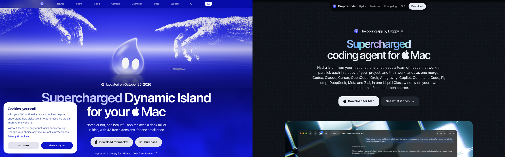
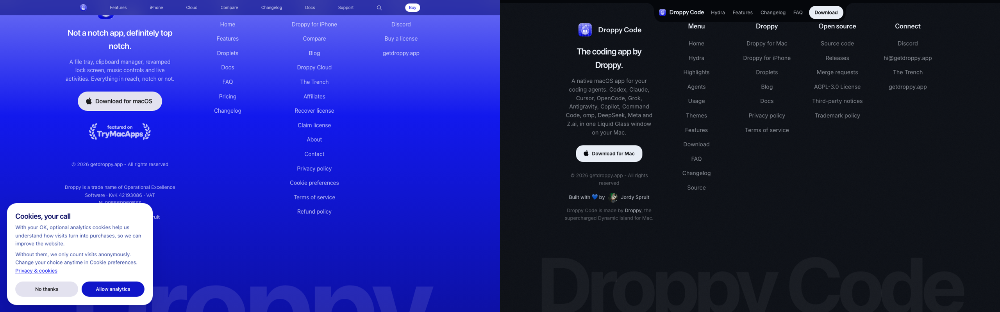

# Cross-site consistency: getdroppy.app and getdroppycode.app

Two sibling marketing sites from one maker. getdroppy.app sells Droppy (paid, "Supercharged Dynamic Island for Mac"). getdroppycode.app gives away Droppy Code (free AGPL, "Supercharged coding agent for Mac"). The Code site's own header comment says it is "the dark sibling of getdroppy.app: same notch dock, same reveal motion, same highlight rail, same pinned wordscroll, same footer, re-tokened for a code canvas". That sentence is now half stale. The shared bones are real, but the nav, the button geometry and the cross-linking have drifted. All numbers below were measured at 1440x900 with Playwright 1.64.1 bundled Chromium on 2026-10-31, plus same-origin CSS reads. Anything I could not load is marked as inference.

## At a glance: top 5 issues

1. The relationship is one way. Droppy Code links to getdroppy.app in at least six places (kicker, two FAQ answers, outro button, footer column, footer byline, JSON-LD author). getdroppy.app links to getdroppycode.app nowhere on the homepage, /compare or /changelog (zero matches for "droppycode" or "Droppy Code" in all three HTML files).
2. The navs are different components. Droppy uses a fixed full width global nav (44px tall, 12px links, blur bar). Code uses the old centered notch pill dock (56px tall, dark #05070b block, 16px semibold links). The Code CSS comment claiming the "same notch dock as getdroppy.app" no longer describes getdroppy.app.
3. Same class names, different shapes. `.btn--applepill` is radius 999px on Droppy and radius 20px on Code. Same for the footer CTA (999px vs 20px). A shared component name now means two things.
4. The download labels disagree. Droppy says "Download for macOS" (hero and footer). Code says "Download for Mac" (hero and footer).
5. Theme meta is missing on one side. Code sets theme-color #0b0e14 and color-scheme dark. Droppy sets neither, so browser chrome falls back to default on the light #f1f0fe page.

## Token by token comparison

| Token | getdroppy.app | getdroppycode.app | Match |
|---|---|---|---|
| Body font | System stack first (-apple-system, SF Pro Text, Inter), 16px | Inter first, 16px | Drift |
| Display font | System stack (SF Pro Display), hero 77.6px, weight 600, tracking -2.33px | Inter Tight hero 62.4px, weight 600, tracking -2.81px; Instrument Sans for H2/nav | Drift (faces), scale close |
| H2 section heading | 48px, weight 600 | 52px, weight 600 | Near (4px apart) |
| Subtitle | 20px, white 86% | 20px, white 55% | Size same, softer on Code |
| Mono | SF Mono stack | SF Mono stack (chips only) | Same |
| Text scale steps | 12/14/16/18/20/24/30/36/48/60 px tokens | Same 12 to 60 px tokens | Same |
| Page background | #f1f0fe (light) | #0b0e14 (dark navy) | Intentional split |
| Accent | Ultramarine rgb(18 25 237), pill dark rgb(16 22 201) | Code blue #4f9cff, text #8cc4ff | Intentional split |
| Text ink | rgb(19 21 105) on light | #e8edf5 primary, 72/55/38% secondaries | Per theme |
| Radius scale | 8/12/16/24/16/24/999 | Identical 8/12/16/24/16/24/999 | Same |
| Glass | blur(20px) saturate(180%), transparent borders | Identical blur and transparent borders | Same |
| Primary button | 999px pill, 56px tall, 17px/600, light bg #e3e2ef, ink #1d1d1f | 20px radius, 17px/600, pad 17px 28px, bg #e8edf5, ink #05070b | Drift (documented as inverse in Code CSS) |
| Secondary button | Same 999px pill, light bg | Glass pill rgba(255,255,255,0.08) plus blur, 20px radius | Drift (same intent) |
| Nav CTA | "Buy", 12px, 24px tall, 980px radius | "Download", 14px/600, 38px tall, 999px radius | Drift |
| Footer CTA | 999px pill, "Download for macOS" | 20px radius, 14px, "Download for Mac" | Drift |
| Button hover | Label to symbol morph, press scale 0.98 | Same morph system, same 0.98 press | Same |
| Nav | Fixed full width bar, 44px, transparent over hero, 12px/400 links, 8 top items plus search | Centered dark pill dock, 56px, bottom radius 24px, 4 anchor links plus Download | Drift |
| Container | 1120px, 24px gutters | 1120px token, 24px gutters; hero inner narrows to 820px | Same |
| Kicker | "Updated on October 25, 2026", links /changelog, 20px | "The coding app by Droppy", links getdroppy.app, 20px | Same slot, opposite jobs |
| Hero pattern | H1 "Supercharged Dynamic Island for your [Apple] Mac", one line, one or two actions, product visual | H1 "Supercharged coding agent for [Apple] Mac", one line, two actions, product visual | Same |
| Footer grid | Brand block plus 3 columns (Menu 7, Navigation 14, Connect 3), giant "Droppy" wordmark | Brand block plus 4 columns (Menu 11, Droppy 7, Open source 6, Connect 4), giant "Droppy Code" wordmark | Same pattern, Code adds a column |
| Footer brand row | 48px icon, tagline, desc, CTA, "© 2026 getdroppy.app - All rights reserved", "Built with blue heart by [face] Jordy Spruit" | Same, plus "Droppy Code is made by Droppy..." line | Same, Code adds madeby |
| Footer extras | TryMacApps badge, legal entity line (KvK, VAT), cookie preferences link | None of those; GitLab source and license links instead | Per product |
| Theme handling | Light page, dark footer sections, no toggle, no theme-color, no color-scheme meta | Dark only, no toggle, theme-color #0b0e14, color-scheme dark | Meta gap on Droppy |
| Title pattern | "Droppy. Supercharged Dynamic Island for Mac" | "Droppy Code. Supercharged coding agent for Mac" | Same |
| Favicon | PNG icon plus WebP apple-touch 180 | ICO plus PNG 96 plus PNG apple-touch 180 | Drift (WebP touch icon on Droppy) |
| OG image | JPG 1200x630, alt "Droppy. Your Mac, just way better..." | PNG 1200x630 (?v=3), alt "Droppy Code. The coding app by Droppy." | Same size, different format |
| Changelog | /changelog | changelog.html plus GitLab releases | Same slot |
| Legal | Privacy, terms, refund, cookies, contact page | Reuses Droppy privacy and terms, adds AGPL, trademark, third-party notices | Good sharing |
| Support | Support page, Discord (discord.gg/droppy), no email link in footer | Discord (discord.gg/2yAjDnVxgF), hi@getdroppy.app twice, no support page | Drift (two Discord invites; inference: likely same server, unverified) |
| Cookie banner | Yes ("Cookies, your call", analytics opt in) | None | Consistent with Code's no telemetry claim |
| App icon | White droplet in blue circle | Binary field in blue rounded square | Distinct per product, same blue family |
| Download offer | Paid license card (measured NT$325.86, one time, lifetime) plus free iPhone tier | "No price." Free AGPL card, Apple silicon and Intel builds plus source | Per product |

Shots: nav plus hero ([Droppy](../shots/cross-droppy-nav-hero.png), [Code](../shots/cross-code-nav-hero.png)), feature section ([Droppy](../shots/cross-droppy-feature.png), [Code](../shots/cross-code-feature.png)), download CTA ([Droppy](../shots/cross-droppy-download.png), [Code](../shots/cross-code-download.png)), footer ([Droppy](../shots/cross-droppy-footer.png), [Code](../shots/cross-code-footer.png)).

## Findings

### 1. Droppy never mentions Droppy Code
Severity: High. Evidence: zero matches for "droppycode" or "Droppy Code" in the homepage, /compare and /changelog HTML of getdroppy.app, while getdroppycode.app links back in the kicker, two FAQ answers, the outro ("Meet Droppy for Mac"), a 7 link footer column, the madeby line and the JSON-LD author field. Why it matters: a visitor who would pay for Droppy can never discover the free coding sibling, and the "same maker" story exists only on one side. Fix: add one "Droppy Code" link to the Droppy global nav Features menu and one row in the footer Navigation column pointing at https://getdroppycode.app/ with the label "Droppy Code (free)".

### 2. The navs are two different components
Severity: High. Evidence: Droppy gnav is fixed, full width, 44px, transparent over the hero, 12px regular links, blur bar with tone switching. Code .nav__pill is a centered 56px dark block with 24px bottom rounding and 16px semibold links. The Code stylesheet comment still claims the same dock as getdroppy.app, which is no longer true of the homepage. Why it matters: the first element a visitor compares across the two tabs looks unrelated, which breaks the sibling read before any content loads. Fix: keep both navs (their IA differs: 8 product sections plus search versus 5 anchors), but fix the stale comment in website/assets/css/site.css lines 1 to 12 and give both CTAs the same 999px radius treatment so at least the action reads as family. Concretely, change Code .btn--sm radius to 999px (it already is 999px; no change needed) and keep the page pills as the documented inverse.

### 3. Shared button class names render different shapes
Severity: Medium. Evidence: `.btn--applepill` computes to radius 999px on Droppy and 20px on Code; `.footer__cta` likewise 999px versus 20px. Both use 17px semibold labels and the same morph hover, so only the corners differ. Why it matters: anyone maintaining both sites from the shared mental model will guess wrong about what the class does. Fix: keep the look on each site, but rename Code's page button to `.btn--apple` (20px) and reserve `.btn--applepill` for true pills, or add a one line comment at each definition naming the other site's value. Cheapest correct fix is the comment; the rename is better if either stylesheet is ever shared.

### 4. Download labels disagree on Mac versus macOS
Severity: Medium. Evidence: Droppy hero trigger and footer CTA read "Download for macOS". Code hero, outro and footer read "Download for Mac", while its pricing card title reads "Droppy Code for macOS". Why it matters: four words for one action across two sibling tabs looks uncoordinated, and within Code the card title and its own button disagree. Fix: use "Download for Mac" on every button on both sites (Code already does except the card title; change the card title to "Droppy Code for Mac"), and keep "macOS" only in requirement lines ("A Mac running macOS 26 or later").

### 5. Typefaces differ while the scale is identical
Severity: Low. Evidence: the 12 to 60px step tokens match exactly, but Droppy sets body and display in the system stack and Code loads Inter, Inter Tight and Instrument Sans. The Code head comment calls these "the getdroppy.app set", which is not accurate: Droppy serves system fonts. Why it matters: headlines across tabs have visibly different texture (77.6px SF Display versus 62.4px Inter Tight), which is fine per theme but currently accidental rather than chosen. Fix: keep both faces (system suits the light page, Inter suits the dark editor canvas; inference), and correct the Code head comment to say the webfonts are Code only.

### 6. One site sets theme-color, the other does not
Severity: Low. Evidence: Code head has theme-color #0b0e14 and color-scheme dark. Droppy head has neither meta. Why it matters: mobile browser chrome and tab theming match the Code page but fall back to default gray on Droppy. Fix: add `<meta name="theme-color" content="#f1f0fe">` to getdroppy.app head. No color-scheme change needed since the page is light.

### 7. Favicon formats differ, including a WebP touch icon
Severity: Low. Evidence: Droppy serves a PNG favicon and a WebP apple-touch-icon (180). Code serves ICO plus PNG 96 and PNG apple-touch 180. Why it matters: iOS Safari handling of WebP touch icons is unreliable (inference), so Droppy's home screen icon may silently fall back on iPhones while Code's works. Fix: add a PNG apple-touch-icon 180 to getdroppy.app and reference it first, keeping WebP as progressive enhancement only if the builder wants it.

### 8. Support paths and Discord invites differ
Severity: Low. Evidence: Droppy footer offers a Support page and discord.gg/droppy with no email. Code footer offers discord.gg/2yAjDnVxgF and hi@getdroppy.app with no support page. Why it matters: a user with a billing question on Code finds no path, and two different invites raise the question of whether there are two servers. Fix: if both invites land on one server (verify with the owner; inference), keep both but add hi@getdroppy.app to the Droppy Contact page footer area and link the Droppy Support page from the Code Connect column.

### 9. Copyright line is identical on a paid and an AGPL site
Severity: Low. Evidence: both footers read "© 2026 getdroppy.app - All rights reserved". Code surrounds it with AGPL, source and trademark links, so the legal picture is complete in context. Why it matters: "all rights reserved" next to a free software download can confuse, but the surrounding links already resolve the confusion. Fix: no change; keep the shared line as the family marker.

### 10. Kicker slots do opposite jobs, which is correct but worth keeping
Severity: Low. Evidence: both kickers are 20px pills above the H1. Droppy's promotes its own changelog date; Code's promotes its parent ("The coding app by Droppy", external link with arrow). Why it matters: this is the one cross-link a Droppy visitor would never see reciprocated, and it works precisely because the sites have a parent and a child. Fix: no change on Code. On Droppy, do not touch the changelog kicker; solve discovery in nav and footer per finding 1 instead.

## Shared token and component recommendation

Keep the intentional splits: ultramarine on light versus code blue #4f9cff on #0b0e14; system type versus Inter/Inter Tight/Instrument Sans; paid card versus free card. These differentiate the products and both pass the purpose test.

Share exactly: radius scale 8/12/16/24/16/24/999 (already identical, freeze it in both files with a comment naming the twin file); text steps 12/14/16/18/20/24/30/36/48/60 (already identical); glass blur(20px) saturate(180%) with transparent borders (already identical); container 1120px with 24px gutters (already identical); footer pattern (brand block, link columns, giant wordmark, shared copyright line, "Built with blue heart by [face] Jordy Spruit" byline); button morph hover and 0.98 press (already identical); title pattern "[Name]. Supercharged [thing] for Mac"; footer CTA with Apple mark plus label.

Adopt Droppy's version for: 999px radius on nav CTA pills (Code already matches here) and the "Buy" style compact CTA height as the small CTA reference (24px tall at 12px in gnav). Adopt Code's version for: theme-color plus color-scheme meta discipline (Droppy should add theme-color per finding 6) and reusing the sibling's privacy and terms links instead of forking them (already done, keep).

## Not checked

Mobile breakpoints and the 833px gnav sheet menu; keyboard focus order on either nav; contrast ratios beyond the computed values quoted; reduced motion behavior; the Droppy download modal, license recovery and purchase flows; Code Intel versus silicon download links (hrefs only, files not fetched); GitLab release history parity with changelog pages; search index parity; analytics payload content on Droppy (banner copy only); any page other than the homepage on Code and other than homepage, /compare and /changelog on Droppy; whether the two Discord invites reach one server.
